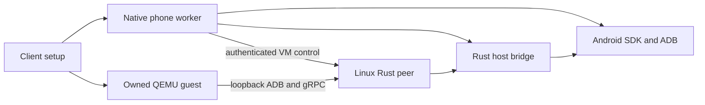

# Native phone / backend bridge

The Rust host runtime supplies an authenticated, fixed-route byte transport for a native phone and its application-owned backend. Windows can keep Android on the native host while its Linux backend retains the existing loopback ADB and emulator gRPC clients.

The only routes are ADB (`127.0.0.1:15037`) and emulator gRPC (`127.0.0.1:8558`) on the native host. The backend listeners remain loopback-only. An installer selects a private host address; wildcard, public and unresolved endpoints are rejected. There is no arbitrary destination, host shell command or Agent tool in this interface. The transport belongs on a trusted private host/backend link.

The [protobuf contract](../../../packages/protocol/proto/ai_phone/v1/host_bridge.proto) carries a version, installation-specific identity and 32-byte pairing secret. Configuration crosses stdin, never command-line arguments. One bounded admission frame authenticates each connection before any target is opened. Original ADB/gRPC bytes then flow unchanged, including HTTP/2 audio and screen streams. Secrets are not returned in the startup receipt. The bridge adds no model round trip, per-action policy layer or automatic replay.

Each listener bounds concurrent connections. Admission has a five-second deadline; continuous media is not subject to that deadline. Half-closes propagate independently. Cancellation closes listeners, aborts and joins their accepted connections, and waits for every listener before returning. A broken action stream remains subject to the runner's existing unknown-result/observation contract.

`host-resources --device-bridge` and the bundled `assistant --device-bridge` share one Rust command dispatcher and implementation. Their stdin/stdout use bounded four-byte-length-prefixed protobuf records. These are installer component interfaces, not steps end users must perform. The startup receipt establishes transport availability only; Android boot, root, authenticated frame capture, required guest applications and complete backend readiness still need their own observations.

The guest peer holds one filesystem lease and records the discovery file present before authentication. Publication rejects files created, removed or changed while pairing, including changes retaining the same owner marker. If discovery was absent, atomic create-only publication also preserves a file appearing during the write. Failed publication does not delete another writer's file. Unchanged owned metadata can be replaced on resume. The lease serializes cooperating peers; replacement of an existing file is not a filesystem-wide compare-and-swap against arbitrary concurrent writers.

## Native lifecycle and automatic pairing

The Windows bootstrap starts the owned QEMU guest and Android in parallel. The phone worker waits for Linux readiness before pairing over the authenticated VM control socket. The phone worker owns the SDK processes and host bridge. A resumed worker re-observes the existing pair.

`--phone-peer-contract` reports `ai-phone-phone-peer-v2` for maintainers invoking the peer directly. The QEMU peer connects to the Windows loopback bridge through its private host gateway at `10.0.2.2`.

Pair identity is stored separately from ephemeral endpoints. When emulator gRPC is in use, the worker reads its SDK token from the private advertisement. Closing the owned connection drains the guest peer and removes its unchanged advertisement.

The authenticated phone status operation reads the expected pair identity and current advertisement, then observes boot, root and a real screenshot through guest ADB. Device provisioning has a separate readiness receipt.

## Runner ADB transport

The phone Runner and native boot observer share `ai-phone-adb`, a Rust client for
the existing loopback ADB server. Shell commands use ADB shell v2 with separate
stdout, stderr and the remote exit code; screenshots retain their raw binary
stream. This removes the Runner's per-command ADB process and its
`AI_PHONE_ADB` executable override. The model-facing API remains protobuf.
The implementation follows the upstream [ADB services](https://android.googlesource.com/platform/packages/modules/adb/+/refs/heads/main/docs/dev/services.md)
and [shell protocol](https://android.googlesource.com/platform/packages/modules/adb/+/master/shell_protocol.h).

Each operation selects the exact serial and keeps the caller's output and time
budgets. A truncated response, missing shell exit or timeout cannot become a
successful action. Cancellation drops the connection; the Runner retains its
action ledger, control epoch and unknown-result handling. No command is retried
by the client. The native SDK still owns the host ADB server, and remaining
media/setup paths still require their documented SDK tools; this change does
not finish Windows first-run integration.

## Qualification and remaining integration

The component has actual two-route transfer, half-close, invalid-credential, frame-boundary and cancellation tests. Maintainer validation also ran a separately compiled Linux Rust process against an existing native Android instance, reading root identity and a real PNG through the bridge. A temporary guest tone produced nonzero gRPC PCM through the native bridge. No accounts, conversations or device disks are inputs to the distributed component.

The Windows guest supplies the Linux x64 ADB tools and AOSP emulator schema. Qualification has exercised pairing, root and PNG readback against the actual Android guest.

## 中文

Rust 桥接组件只转发原生手机的 ADB 与模拟器 gRPC，两条路由固定，客体监听保持本机回环。安装器通过标准输入传入 protobuf 配置和独立配对密钥；每个连接只核验一次，不增加模型调用、逐动作设卡或自动重放。取消时关闭监听并等待全部连接退出，未知动作结果仍由原 Runner 的观察/回执机制处理。

Windows 并行启动 Android 与 QEMU Linux。Linux 就绪后，手机工作进程通过认证控制通道配对。状态查询核验配对身份和当前地址记录，实际读取 Android 的启动状态、root 和画面。
